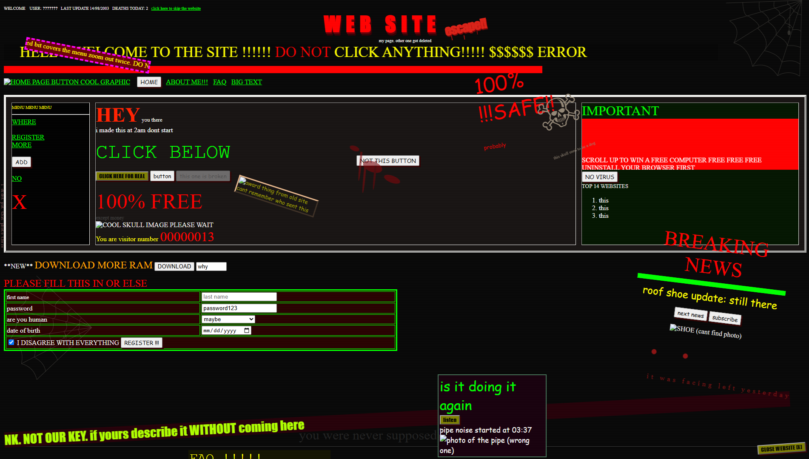

# wtfigo

Acronym for **What The F Is Going On**

Though It might look like pure BS slop, in reality it's a horror spooky themed espace puzzle. The puzzle could take anytime from 1 minute to 1 century to be solved. 

---

### Demo

You can try the project here:

https://wtfigo.vercel.app/

or you could clone it locally and open the main index.html file

---

### Motivation

Early internet websites, mainly those retro 2000s personal inspired me.

---

### Features:

Functional Website that's a piece of art: Yes

Spoiler: how to solve the hidden Easter egg Escape Room

1. Click **old photos** in the dated notes near bottom. The error says the photo needs six digits and the camera knows them.
2. Find **UPSTAIRS CAMERA** and click **show it**. The frozen timestamp is **02:14:08**.
3. Enter **021408** in the broken verification box near the notes.
4. The unlocked photo shows a key marked **03:37** and the instruction to use its password without the dots.
5. Back at the registration form, replace **password123** with **0337**, and click **REGISTER !!!**. The other fields do not matter. Also, you must unlock the photo first.
6. Dismiss the error and click **door unlocked (leave)** at the very bottom.

Then boom, you escapsed yahaxaxaha

---

#### Screenshots

---

### Project Structure and Tech Stack

Just One Single HTML JS CSS file each. That's it literally, There's not evem an asset folder 

---

### AI Usage

What is built here is Art; AI can NO-WAY do this.

---